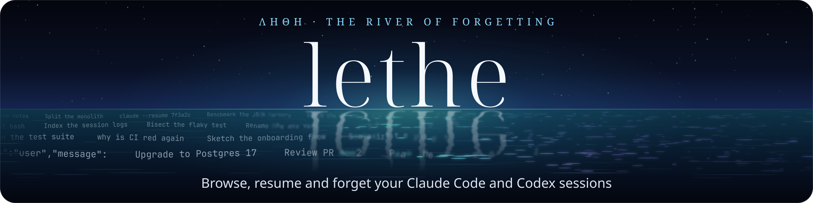

One picker for every conversation your AI coding agents left on disk. It never touches a session that is still running.

[](https://github.com/C0sm0cats/lethe/actions/workflows/test.yml)
[](LICENSE)




In Greek myth, Lethe is the river of forgetting. Your agents never forget: after a few weeks you have hundreds of sessions spread over `~/.claude` and `~/.codex`. There are one-shot runs, abandoned subagents, sessions you opened and closed, and transcripts of several hundred megabytes. Neither agent lets you see them all, let alone clean them up.

```sh
curl -fsSL https://raw.githubusercontent.com/C0sm0cats/lethe/main/install.sh | sh
```

On Linux and macOS. The installer puts lethe in `~/.local/bin`, adds it to your `PATH`, and tells you the exact command to install anything missing (`fzf`, `jq`, `sqlite3`, a recent `bash`). lethe is one Bash file: no runtime, no daemon, nothing to build.

## Features

- **Every session, one list.** Claude Code and Codex side by side, with age, size, project and title, and a live preview of the conversation.
- **Resume anything.** `Ctrl-R` reopens a session in its agent, in the directory it was started from. `Ctrl-K` forks it into a new session, and `Ctrl-E` exports it as Markdown.
- **Clean up in seconds.** Mark with `Tab`, delete with `Ctrl-D`. Or `lethe delete --older-than 1m --keep 3`.
- **Running sessions are untouchable.** Sessions open in a running agent, or active in the last 10 minutes, are detected and skipped. Always, even with `--yes`.
- **Undo.** Deleted Claude Code sessions go to a trash and can be restored. Codex sessions can be archived instead of deleted.
- **The conversation as it is now.** When you edit or rewind an earlier prompt in Claude Code, the old branch stays in the transcript. lethe shows the active branch only, marks sessions that have abandoned branches with `⑂N`, and shows those branches on demand (`Alt-B`, `--all-branches`).
- **Find what to clean.** `Ctrl-F` and `Ctrl-W` open menus that show how many sessions and how much space each cleanup filter and each project holds: empty sessions, projects you deleted, idle ones, the biggest ones. Or search the text of every conversation.
- **Scriptable.** `list --json`, `stats`, `--dry-run`, `--yes` for cron, and tab completion.

## Install

```sh
curl -fsSL https://raw.githubusercontent.com/C0sm0cats/lethe/main/install.sh | sh
```

That is all. The [installer](install.sh) is short and readable; it:

1. downloads `lethe` to `~/.local/bin`;
2. adds that directory to your `PATH` if needed, in the startup file of your shell (`~/.zshrc` or `$ZDOTDIR/.zshrc`, `~/.bashrc`, `~/.bash_profile` on macOS, fish), then asks you to open a new terminal;
3. checks the dependencies and prints the command to install the missing ones for your system.

Run it again to update lethe.

Two options, set in front of `sh`, if you need them:

```sh
# install a given release instead of the latest version
curl -fsSL https://raw.githubusercontent.com/C0sm0cats/lethe/main/install.sh | LETHE_VERSION=v0.6.0 sh

# install in another directory than ~/.local/bin
curl -fsSL https://raw.githubusercontent.com/C0sm0cats/lethe/main/install.sh | LETHE_BIN=~/bin sh
```

**By hand**, if you prefer:

```sh
mkdir -p ~/.local/bin
curl -fsSL -o ~/.local/bin/lethe https://raw.githubusercontent.com/C0sm0cats/lethe/main/lethe
chmod +x ~/.local/bin/lethe
```

If `lethe` is then "command not found", add `~/.local/bin` to your `PATH` (`echo $SHELL` tells your shell):

```sh
echo 'export PATH="$HOME/.local/bin:$PATH"' >> ~/.zshrc         # zsh: macOS default, created if missing
echo 'export PATH="$HOME/.local/bin:$PATH"' >> ~/.bashrc        # bash on Linux
echo 'export PATH="$HOME/.local/bin:$PATH"' >> ~/.bash_profile  # bash on macOS
```

Packaging recipes for Homebrew and the AUR are in [`packaging/`](packaging/).

Dependencies:

| System | Command |
| --- | --- |
| macOS | `brew install bash fzf jq sqlite` |
| Debian, Ubuntu | `sudo apt install fzf jq sqlite3` |
| Fedora | `sudo dnf install fzf jq sqlite` |
| Arch, Manjaro | `sudo pacman -S fzf jq sqlite` |
| Alpine | `sudo apk add bash fzf jq sqlite` |

Versions: bash 4.4+ (macOS ships 3.2, hence `brew install bash`) and fzf 0.45+ (0.63+ for the panel layout). lethe works with whichever agents you have; you don't need both.

Tab completion: add `source <(lethe completion zsh)` to `~/.zshrc`, or `source <(lethe completion bash)` to `~/.bashrc`.

## Usage

```sh
lethe                          # the picker
lethe stats                    # what takes space, with cleanup suggestions
lethe list --claude --sort size
lethe list --running           # what is open right now
lethe resume 01a11ee1          # unique id prefixes work everywhere
lethe fork 01a11ee1            # a copy to continue in another direction
lethe export 01a11ee1 > notes.md
lethe export 01a11ee1 --all-branches   # with abandoned branches, labelled (abandoned)
```

### Picker keys

Everything the command line can do, the picker can do too.

| Key | Action |
| --- | --- |
| `Tab` | mark / unmark |
| `Ctrl‑A` | mark / unmark all visible sessions |
| `Ctrl‑D` | delete the marked sessions (or the current one) |
| `Ctrl‑X` | archive / unarchive (Codex) |
| `Ctrl‑R` | resume the session in its agent |
| `Ctrl‑K` | fork: continue in a copy of the session |
| `Ctrl‑E` | export the conversation to `./lethe-ID.md` |
| `Enter` | read the whole conversation in your pager |
| `Ctrl‑Y` | copy the command that resumes the session |
| `Ctrl‑T` | agent: all, Claude Code or Codex |
| `Ctrl‑S` | status: all, running, idle or archived |
| `Ctrl‑F` | cleanup filter menu, with counts and sizes |
| `Ctrl‑W` | project menu, biggest first |
| `Ctrl‑G` | find the typed text in the conversations ([details](#searching-conversations)) |
| `Ctrl‑O` | sort: by date, by size or oldest first |
| `Ctrl‑P` | show / hide the preview |
| `Ctrl‑B` | disk usage of the listed sessions, in the preview |
| `Alt‑B` | show / hide abandoned branches (`⑂`) |
| `F1` | all keys, or only the essential ones |
| `Esc` | quit |

In the trash view, `Ctrl-R` restores a session and `Ctrl-D` deletes it for good. Typing filters the list by title, project, agent or mode. Command-line filters apply too and show in the prompt: `lethe --dir ~/work --older-than 2w`. `Ctrl‑F` and `Ctrl‑W` narrow them further, and `--grep` becomes the `Ctrl‑G` search.

The footer lists the keys and shows where each switch stands (`Ctrl‑T agent: claude`, `Ctrl‑O sort: size`…). The cleanup filter menu (`Ctrl‑F`) offers empty sessions, orphans (project directory gone), missing transcripts, sessions idle for 30 or 90 days, and the trash.

| Icon | Meaning |
| --- | --- |
| `●` | idle session |
| `◌` | archived session (Codex) |
| `◉` | running: open in an agent, protected |
| `◔` | running: active in the last 10 minutes, protected |
| `✗` | indexed by Codex, but the transcript file is gone |
| `↺` | in the trash, restorable |
| `⑂N` | N abandoned branches (edited or rewound prompts), hidden |

Sizes over 10 MB are yellow, over 50 MB red.

### Searching conversations

Type a word, then press `Ctrl‑G`: the list keeps the sessions whose conversation contains it, the preview shows only the messages that mention it, highlighted ("8 of 22 messages mention …"), and `Enter` opens the conversation on the first occurrence. Press `Ctrl‑G` again with an empty search to clear it.

### Cleaning up from the command line

```sh
lethe delete --empty                       # sessions without a single message
lethe delete --orphans                     # projects you have deleted or moved
lethe delete --older-than 1m --keep 3      # idle for a month, but keep the last 3 of each project
lethe delete --codex --mode exec --older-than 1w
lethe delete --grep "api key" --dry-run    # preview what would be deleted
lethe archive --dir ~/old-project          # hide a finished project from codex resume
lethe delete --older-than 6m --yes         # no prompt, e.g. from cron
```

Destructive commands show the sessions they will change and ask for confirmation. Without a terminal they require `--yes`. With no filter at all they require `--all`.

### Trash (Claude Code)

```sh
lethe trash                    # list trashed sessions
lethe trash restore 7f3a       # put a session back, exactly where it was
lethe trash empty --older-than 30d         # what was trashed more than 30 days ago
```

The trash lives in `~/.local/share/lethe/trash`. Restoring never overwrites existing files, and is all or nothing: if a file cannot be put back, the session stays whole in the trash.

### Filters

| Filter | Matches |
| --- | --- |
| `--claude`, `--codex` | one agent (also `--agent NAME`) |
| `--running`, `--idle`, `--archived` | session status (`◉` `◔`, `●`, `◌`) |
| `--unarchived` | all but archived sessions (formerly `--active`) |
| `--older-than D` | last activity before `D` ago: `12h`, `30d`, `8w`, `6m`, `1y` |
| `--newer-than D` | last activity within `D` |
| `--dir PATH` | sessions started in `PATH` or below it (repeatable; symlinks are followed) |
| `--mode MODE` | `cli`, `exec`, `vscode`, `subagent`, … |
| `--provider NAME` | `anthropic`, `openai`, … |
| `--grep TEXT` | the conversation contains `TEXT` (any case, any branch) |
| `--empty` | sessions with no message and no reply |
| `--orphans` | sessions whose project directory no longer exists (an unmounted disk or an unreadable parent does not count) |
| `--missing` | Codex index entries whose transcript is gone |
| `--keep N` | spares the `N` most recent sessions of each project, both agents together |
| `ID…` | session ids or unique prefixes |

```sh
lethe list --json | jq -r '.[] | select(.size > 50000000) | "\(.agent) \(.id) \(.title)"'
```

## How it stays safe

- **Running sessions.** A session is protected when:
  - a running process holds its transcript open (this is how Codex works);
  - Claude Code lists it in `~/.claude/sessions/` with a live process, checked against the process start time so that a recycled PID doesn't count;
  - it is an unfinished Claude Code background job;
  - it was active in the last 10 minutes.

  Protection is checked when the plan is shown, and again right before each change: a session that was opened, written to or moved in the meantime is left alone. `--force` lifts only the 10-minute rule. If a running agent's open files cannot be listed, lethe changes nothing. Homes reached through symlinks (`~/.codex` in a dotfiles repo, say) are resolved.
- **Pinned Codex sessions** are skipped by filters (`--older-than`, `--empty`…): only naming them, by id or in the picker, changes them.
- **Subagents.** Deleting a Codex session also deletes the subagent sessions it spawned, children first. A subagent whose parent is running is protected, and so is the whole tree of any protected session. Claude Code subagent transcripts live inside their session and go with it.
- **Codex** is changed only through its own CLI (`codex delete`, `codex archive`, `codex unarchive`). Every change is checked in its database afterwards.
- **Claude Code** has no delete command. lethe moves the transcript and everything Claude Code keeps for that session (subagent transcripts, tool results, file history, session environment, its prompts in the prompt history) to the trash, with a manifest to restore it. A session is moved entirely or not at all, and a restore only writes inside the Claude Code directory.
- **Resume** refuses a session that is already open in a running agent (two agents writing one transcript would interleave it); fork it instead.
- **Read-only by default.** Listing, searching and previewing never write to the agents' data. The Claude Code index is a cache in `~/.cache/lethe`.

## Configuration

| Variable | Default |
| --- | --- |
| `CLAUDE_CONFIG_DIR` | `~/.claude` |
| `CODEX_HOME` | `~/.codex` |
| `XDG_DATA_HOME` | `~/.local/share` (trash) |
| `XDG_CACHE_HOME` | `~/.cache` (Claude Code index) |
| `NO_COLOR` | colors on |
| `PAGER` | `less -R` |

## Development

```sh
tests/run.sh                                  # throwaway homes, fake codex: never touches your sessions
uv run --with pyte python docs/make_demo.py   # re-record the README demo (needs tmux)
```

## Contributing

Contributions are welcome! Feel free to open an issue or submit a pull request.

## License

This project is licensed under the MIT License. See the [LICENSE](LICENSE) file for details.

---

Built with ❤️ by C0sm0cats
